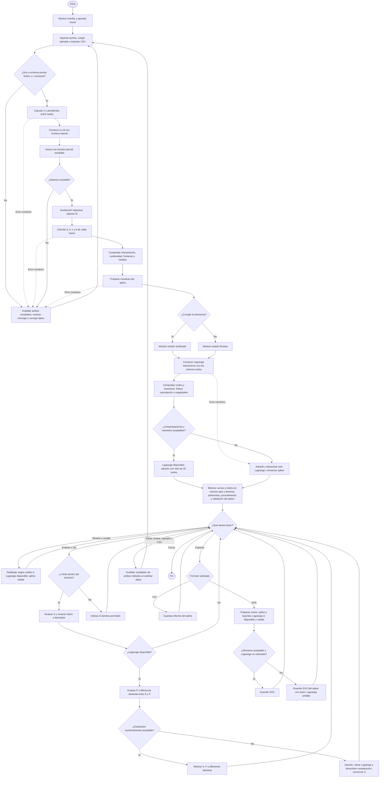

# Diagrama del programa · Tercera entrega (semana 11)

La versión vectorial está en [diagrama_flujo.svg](diagrama_flujo.svg). Este código Mermaid permite mantener el diagrama editable.



En el SVG, los círculos con la misma letra indican continuidad entre bloques:
**A** continúa con Lagrange; **R** vuelve a las acciones; **E** evalúa;
**X** exporta; **D** cambia datos; **I** vuelve a la entrada.

Los errores de entrada, resolución o magnitudes del spline invalidan los
resultados. Un estado **Revisar precisión** no impide intentar Lagrange.
Su comprobación en nodos y el muestreo no garantizan precisión uniforme.
Ocultar Lagrange no impide evaluarlo. La diferencia entre interpolaciones
no es un error respecto de una función original desconocida.

Los ejemplos y una importación válida recalculan automáticamente. Editar o
limpiar invalida resultados hasta recalcular. Una importación fallida conserva
el texto anterior e invalida los resultados. Cancelar un diálogo conserva el
estado; un error de archivo muestra un mensaje. El cierre está disponible
en cualquier momento.

Para regenerar solo el SVG desde la raíz, sin actualizar otras evidencias:

```console
python -c "from pathlib import Path; from tools.generar_evidencias import diagrama_svg; Path('docs/diagrama_flujo.svg').write_text(diagrama_svg(), encoding='utf-8')"
```
